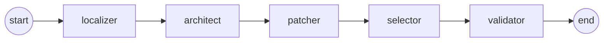
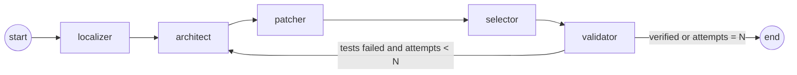
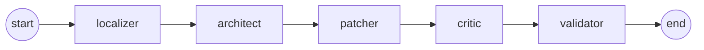
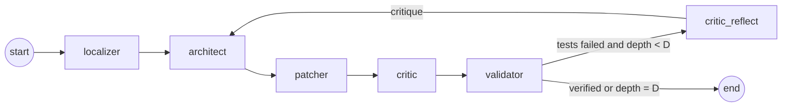
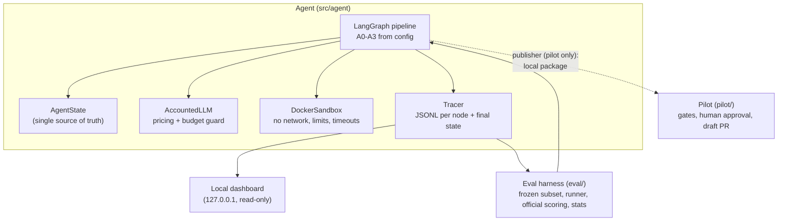

# An Ablation Study of LLM Agents for GitHub Issue Resolution

**Research question:** does an Architect/Critic *reflection loop* improve the rate of
sandbox-verified patches over simpler baselines, and at what cost?

This repository is an **evaluated engineering system** built for a final-year project. It
contains four agent pipelines (A0–A3) for fixing GitHub issues:

- The pipelines share one state model, toolset, Docker sandbox, budget guard and tracer.
- They differ **only** in graph wiring, selected by config.
- They are evaluated on a frozen, preregistered subset of SWE-bench Lite with official
  scoring and paired statistics.

> **Status:** the system, the harness and the safety gates are implemented and tested
> (`make check`). **No benchmark results exist yet.** Frozen runs wait on preregistration
> and an evaluation host; see [docs/EVAL_SETUP.md](docs/EVAL_SETUP.md). The write-up
> scaffold is [docs/REPORT_SKELETON.md](docs/REPORT_SKELETON.md).

## The four variants

| Variant | Pipeline | Knobs |
|---|---|---|
| **A0** | single-shot patch, validated once | — |
| **A1** | single-shot + sandbox test feedback, retry | N (max attempts) |
| **A2** | Architect proposes K candidates, Critic selects one | K, critic on/off, critic-uses-sandbox |
| **A3** | Architect → Critic → reflect → revise | K, D (max reflection depth), critic switches |

All variants run `localizer → architect → patcher → select → validator`.
- **select:** an LLM Critic scoring a rubric, or, with the critic off, a seeded-random
  pick among applicable candidates.
- **Abort edges:** every node also has an abort edge to END when the budget is exhausted
  or an error occurs. These are omitted from the diagrams below.
- **Drift test:** the diagrams are checked against the compiled graphs by
  `tests/test_readme_diagrams.py`, so they cannot drift from the code.

**A0: single shot**
<!-- graph:A0 -->


**A1: retry with sandbox test feedback** (`attempt_count < N`)
<!-- graph:A1 -->


**A2: K candidates, Critic selects**
<!-- graph:A2 -->


**A3: Architect / Critic reflection loop** (`attempt_count < D + 1`)
<!-- graph:A3 -->


## Architecture



- **State** (`src/agent/state.py`): one `TypedDict`. Nodes return partial updates and
  never mutate their input; a test deep-copies the state around every node to check this.
  - `validation_results` and `critic_notes` are append-only.
  - `candidates` is upsert-by-index, so the full history is kept.
- **Tracing** (`src/agent/tracing.py`): one JSONL file per run.
  - Contents: `run_start` (config, git sha, package versions, pricing), one `node` record
    per node (input hash, tokens, cost, latency, sandbox exit codes), and `run_end`
    (totals and a pointer to the full final state).
  - `validate_trace` rejects incomplete or tampered traces. Untraced runs are invalid,
    and the analysis excludes them.
- **Budget guard** (`src/agent/budget.py`): a worst-case cost check **before** every LLM
  call, at per-run and per-experiment level. Over-budget runs end cleanly as
  `budget_exceeded` with a complete trace.
- **Sandbox** (`src/agent/sandbox/`): a real Docker container per run.
  - Isolation: `network_mode=none`, memory/CPU/PID limits, and hard timeouts.
  - Patches are applied with `git apply`, as in SWE-bench scoring.
  - Never mocked in tests.
- **Termination:** every graph cycle passes through `architect`, which increments
  `attempt_count`. Every back-edge is guarded by `attempt_count < max_rounds()`.
  `tests/test_termination.py` checks this structurally for all 38 valid configurations in
  the ablation grid.
- **Critic** (`src/agent/nodes/critic.py`): pydantic-validated JSON scores (correctness
  likelihood, minimality, test impact, risk; each 1–5), with a deterministic fallback if
  its pick is invalid. Routing never parses free text.

## Repository layout

```
src/agent/        agent: state, graph, nodes, LLM accounting, budget, sandbox, tracing,
                  publishing (local PR packages), dashboard (local trace viewer)
eval/             harness: frozen data, preregistration gate, runner, official scoring,
                  statistics, analysis, failure taxonomy, results notebook
pilot/            controlled live pilot: GitHub client, safety gates, approval, publish,
                  outcomes, optional code-health scan
configs/          a0-a3 (fixture), eval/ (SWE-bench), pilot/ (live), pricing.yaml
docs/             EVAL_SETUP, PREREGISTRATION, PILOT, REPORT_SKELETON, RESUME_BULLETS
tests/            unit + real-Docker tests; fixtures/ (tiny calc repo + sandbox images)
```

## Quickstart

Requirements: Python 3.11+, [uv](https://docs.astral.sh/uv/), Docker.

```bash
uv sync --all-groups
make check                                   # ruff, mypy --strict, pytest (real Docker)

export ANTHROPIC_API_KEY=...                 # never commit secrets
uv run python -m agent.run --config configs/a1.yaml \
    --instance tests/fixtures/instances/calc_001.json

make demo-traces dashboard                   # scripted demo runs, then http://127.0.0.1:8765
```

## Reproducing the study

Full requirements are in [docs/EVAL_SETUP.md](docs/EVAL_SETUP.md): an x86-64 host with
about 250 GB of disk and at least 16 GB of RAM.

```bash
make eval-dev                     # 1. tune/measure on the 15-instance dev set ONLY
#                                   2. fill in docs/PREREGISTRATION.md and commit it, with a
#                                      clean tree (the harness refuses frozen runs otherwise)
make eval-full WORKERS=4          # 3. A0-A3 x seeds 0,1,2 on the frozen 75-instance subset,
#                                      then official SWE-bench scoring (unmodified harness)
make analyze                      # 4. analysis/: report.md, CSVs, frontier plot, taxonomy CSV
make docs                         # 5. fill report/resume placeholders from analysis outputs
```

- **Data:** frozen at `eval/data/subset_v1.json`, a stratified sample of SWE-bench Lite
  pinned to a dataset revision. A test fails if the file changes. The dev set is disjoint
  from it, and only the dev set is used for tuning.
- **Statistics:**
  - Primary unit: per-instance majority over 3 seeds.
  - Tests: exact McNemar for H1 (A1>A0), H2 (A2>A1) and H3 (A3>A2), with Holm correction.
  - Uncertainty: instance-level bootstrap 95% CIs.
  - Also reported: seed variance, cost per resolved instance, and Critic quality.

## Live pilot (opt-in, human-gated)

[docs/PILOT.md](docs/PILOT.md) covers the path from a real issue to a draft PR.
- **The agent never contacts GitHub.** It only writes a local package for a
  sandbox-verified patch.
- **Publishing requires** `--publish`, a per-PR human approval bound to the package hash,
  a repository allowlist, an AI-contribution-policy check, rate limits and caps.
- **Every PR** is a draft titled `[AI-Generated Patch] …`, carries a full disclosure, and
  sits on an `ai-patch/` branch.

## Testing

`make test` runs everything offline. The opt-in tests (`--run-live`, `--run-swebench`,
`--run-github`) call real external services.

| What | How it is tested |
|---|---|
| Sandbox | real Docker containers, never mocked |
| Graph routing (every edge, budget aborts, max depth) | scripted LLM (`tests/fake_llm.py`) + real Docker |
| Runner, publisher | scripted LLM + real Docker (avoids paying for API calls in tests) |
| Termination | structural cycle check + router simulation over the whole ablation grid |
| Statistics | known closed-form values (exact McNemar, Holm, bootstrap) |
| Frozen data | sha256 checksum and disjointness tests |
| GitHub | in-memory fake recording every call; a local HTTP server for the REST client |
| SWE-bench integration | opt-in: pulls one official image; the gold patch must resolve |

## Safety and ethics

- **Secrets:** only from environment variables; redacted from traces, artifacts and
  errors.
- **Isolation:** the sandbox has no network and no secrets. Issue text is treated as
  untrusted input.
- **Anti-leakage:** gold tests, gold patches and hints never enter agent state. The
  agent's regression command reveals only the paths of existing test files, which is a
  documented threat to validity.
- **Pilot:** draft PRs only, human approval per PR, an allowlist, policy checks and volume
  limits. Repositories that prohibit AI contributions are blocked.
- **Static analysis** is limited to code health and logical bugs.

## Limitations

- **No results yet.** Every result in the report is a placeholder until the frozen runs
  complete.
- **Single model family** (Claude). The API offers no seed or temperature control, so the
  seeds capture run-to-run variation only.
- **Weak feedback signal.** The SWE-bench feedback for A1/A3 is the existing regression
  tests, which is weaker than the hidden tests.
- **Small sample.** n = 75 limits statistical power to fairly large effects.

TODO (author): choose and add a license.
